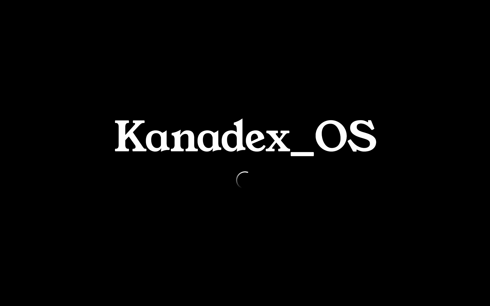

# 视觉与动效

## 一句话

夜色里的一张桌子：冷色的天、暖色的灯、奶油色的纸窗口。
窗口像贴在桌面上的纸，灯是唯一的光源，动效都跟着灯的节奏走。

## 颜色

| 令牌 | 夜色（默认） | 用途 |
| --- | --- | --- |
| `--sky-top` / `--sky-bottom` | `#0d0f26` → `#241f4f` | 夜空渐变 |
| `--hill-1/2/3` | `#262049` / `#1b1737` / `#100e24` | 三层山丘剪影 |
| `--desk-1/2` | `#2a2344` → `#171330` | 桌面 |
| `--paper` | `#f7f1e3` | 窗口纸面（两套主题都不变） |
| `--ink` | `#17130d` | 纸上的墨 |
| `--lamp` / `--lamp-hot` | `#d9822b` / `#ffd39b` | 灯罩与灯泡 |
| `--term-bg` | `#17140f` | 终端窗口 |
| `--icon-ink` | `#1f2937` | 漫画图标描边（唯一的图标线宽色） |

蓝紫的夜配奶油纸，是为了让"窗口是纸"这件事一眼成立；
唯一的暖色留给灯，屏幕上最亮的地方永远是灯照到的地方。

## 字体

- 展示体：**Young Serif**（自托管，`public/fonts/young-serif-latin.woff2`，OFL 1.1）。
  名字、窗口标题、顶栏链接、按钮用它。这是参考站 `--serif` 的同一个字形，
  不是"用 Georgia 加粗 + 描边凑出来"的替代品——那种模拟放大就露馅。
- 正文体：**Literata**（自托管，正体 + 斜体）。长段文字与手写标注用它，斜体是真斜体。
- 漫画字：**ZCOOL KuaiLe**（自托管子集，`public/fonts/zcool-kuaile-ui.woff2`，OFL 1.1）。
  只给桌面入口标签（终端 / 关于 / 项目 / 笔记 / 联系 / GitHub）与项目卡状态章用，子集是
  ASCII + 站内用到的 21 个汉字，6KB。它不进正文；换标签文案要按 `fonts.css` 里那条子集命令
  重新生成，缺字回落楷体。换文件要连同文件名一起换，浏览器会照旧缓存同名 woff2。
- 代码与命令：Cascadia Code / JetBrains Mono / ui-monospace。
- 中文：两份字体都只带 latin 子集，中文回落到 Songti SC / Noto Serif SC / KaiTi。

**运行时零外部请求**：字体文件跟着仓库走，构建时打进 `dist/fonts/`，断网也完整。
禁止为了让"不引外部资源"这句话成立，改用系统字体去模拟一个已知字形。

## 形状

- 窗口圆角 `16/12/18/11`，四角不等，像手工裁的纸。
- 三个控制圆点直径 13px，悬停才显形（和桌面系统一致）。
- 桌面图标是**漫画风格 SVG**，不是"2px 墨线 + 偏移投影"的几何块：
  见下面「图标」一节。
- 手绘描边用 SVG `feTurbulence + feDisplacementMap` 滤镜（`InkDefs`）——只用于纸面边框与便签，
  **图标上不用滤镜**（滤镜会把粗描边糊成灰边，平涂色也会脏）。

---

# 台灯

灯是场景的光源，不是装饰。它的职责只有一条：**照亮当前被操作的那个东西**。

## 三层关节（硬契约）

```
lamp__lean   底座夹具 + 下臂        transform-origin: 底座关节
lamp__upper  上臂                   transform-origin: 中间关节
lamp__head   灯颈 + 灯罩 + 光锥 + 桌面光池   transform-origin: 灯头关节
```

- 三层各自 `rotate()`，各有自己的原点；**禁止对整张 SVG 做整体旋转**。
- 光锥与光池挂在 `lamp__head` 组内：灯头一转，光就同源转，不允许各转各的。
- 灯罩内面必须有一块暖色高光（`shade-in`），否则光锥看起来是贴在画面上的形状，不是光。
- 灯罩**有壁厚**：罩体 + 罩口半椭圆（开度 `ry/rx = 84/138`）+ 内唇线。
  罩口只画朝外的半圈 + 弦；画整圈会让另一半冒到罩体外面，像贴了个鸡蛋。
- 底座有**接触阴影**（画在灯组外、不跟着转），否则灯是浮在桌面上的。
- 逐帧写 `style.transform`，**禁止用 CSS transition 驱动台灯**：
  跟手必须是帧级连续量，离散过渡会让灯"一顿一顿"。

## 角度：三层幅度递减，灯头吃掉余量

设 `delta` = 目标方向相对灯头**静止朝向**的夹角（度，屏幕坐标系，顺时针为正）。

| 层 | 取值 | 说明 |
| --- | --- | --- |
| lean | `clamp(delta × 0.07, -4°, +4°)` | 底座最小，只做"重心挪一下"的感觉 |
| upper | `clamp(delta × 0.30, -13°, +13°)` | 中关节，约灯头的 1/3 |
| head | `axis − upper − lean`（axis 是弹簧量，目标 = delta，钳在 ±72°） | 灯头吃掉全部余量 |

**为什么 head 不写死 ±34°。** 三层是串联的：lean 与 upper 已经把灯头挪到别处了，
只有让 head 吸收"剩下的角度"，光锥才会真的落在目标上。
写死上限的结果是"灯在转，光没到"——所有远处目标都差几度，看起来像贴纸。
所以上限只给 lean / upper，head 是导出量。三层依然是递减的：4° < 13° < 72°。

**为什么是 0.07 / 0.30。** 这两个比例来自公开站点的在线实现（见文末「参数来源」），
实现是本仓库独立重写的弹簧与几何，没有复制其代码。

## 弹簧

半隐式欧拉积分，每帧（含 `dt` 上限 34ms、1/120s 子步）：

```
c  = 2 * sqrt(k) * zeta          // 阻尼系数，zeta 是阻尼比
a  = k * (target - value) - c * v
v += a * dt
value += v * dt
```

| 轴 | k（刚度） | ζ（阻尼比） | 行为 |
| --- | --- | --- | --- |
| axis（目标方向） | 有目标 125 / 无目标 85 | 0.56 | 有目标时更"急"，回静止位时更松 |
| upper | 125 × 0.45 ≈ 56 | 0.62 | 略过阻尼，不抖 |
| lean | 125 × 0.30 ≈ 38 | 0.50 | 稍微欠阻尼，底座轻微晃 |
| bob（呼吸） | — | — | 静止 ≥1.2s 后 `sin(t / 640ms) × 1.3°` 加到 head |
| glance（走神） | — | — | 静止时每 8–12s 甩一次 `+17°` 或 `−9°`（`back.out(1.6)` 0.55s，停 1.2s，`power2.inOut` 0.7s 回 0） |
| nod（点头） | — | — | 点到目标时 `−8°` 0.13s 下、0.2s 上 |

ζ≈0.5–0.6 意味着 5–10% 的过冲：灯头会甩过一点点再回来，这就是"有物理感"的来源。
不要为了"稳"把 ζ 提到 1，那会让灯变成机械臂。

**静止不是归零。** 没有目标时灯回到"桌面静止朝向"（桌面左前方的光池位置），不是回到 0°；
归零会让灯在空闲时僵直地盯着正前方，和场景里"灯照桌子"的叙事冲突。

## activeTarget：灯指谁

**灯追的是"当前被操作的可交互目标"，不是鼠标坐标。** 这是这一节唯一不能破的规则。
鼠标在空白处移动、画圈、抖动，灯**一动不动**。

候选优先级（每帧解析，只有一个 activeTarget）：

1. `touch`：移动端 `touchstart` 用 `document.elementFromPoint` 命中的目标（粘 2s）
2. `hover`：指针 `pointerenter` 命中的桌面图标 / dock chip（离开即失效）
3. `focused`：当前获得焦点的窗口（由 `windowStore.focused` 单一来源派生）
4. 以上都空 → 桌面静止朝向（不属于任何 DOM 节点）

规则：

- **注册**：窗口、桌面图标、dock chip 挂载时注册自己的 DOM 引用，卸载时注销。
  键名 `win:<id>` / `obj:<key>` / `dock:<id>`，统一走 `src/app/aimRegistry.ts`。
- **切换**：`hover` 进入即成为 activeTarget；离开立刻回落到 `focused`，不需要计时器。
  窗口获得焦点时 `focused` 变化，灯自己会转过去。
- **指向点**：目标的 `getBoundingClientRect()` 中心，转到灯所在的 SVG 局部坐标，
  以**灯罩口**（`viewBox 139,341`）为极点算角度。矩形缓存 120ms 刷新，
  避免每帧读布局；窗口最大化/还原过程中不追（矩形在动，追会晕）。
- **移动端**：`touchstart` 命中目标 → 指过去；`touchmove` 离开目标**保持**当前指向；
  `touchend` 后 2s 缓慢回落到 `focused`/静止位。禁止用手指坐标直接驱动台灯——
  那会变成"灯跟着手指乱甩"，是最廉价的假 3D。

## 光

- 光锥是**三道有边的锥**：外锥 / 中锥 / 内芯，外缘 3px 暖色描边。
  没有描边的锥无论怎么调渐变都像雾——边界本身就是"光从哪来"的信息。
- 锥长按画布单位给到 **2500**（缩放后约 860px），任何角度都能扫到桌面；
  太短的光锥会停在半空，变成悬浮的色块。
- 光从**罩口平面**（`O = M + u × rimRy × 0.82`）射出，不是从罩体背后的弦上射出。
- **没有独立的光池。** 光斑只能是光锥自己的末端；单独画一个椭圆跟 head 平移，
  它就会飘在空气里。
- 桌面光池是灯头组的子元素，额外叠加 `translateX(head × 4px)`：灯头横摆时光斑跟着走。
- 光锥呼吸 `9s`（`beam-breathe`），只在灯亮着时；`prefers-reduced-motion` 下关掉。
- 灯不响应点击：`.lamp` 所在舞台层 `pointer-events: none`，它只被"目标"驱动。

---

# 图标

## 视觉规范（桌面图标与 dock chip 共用一套）

- **粗深色描边**：`stroke: var(--icon-ink)`（#1F2937），`stroke-width 2.6`（48 画布），
  `stroke-linejoin/linecap: round`。不是细线 linear icon。
- **平涂粉彩填充**：每个应用一个固定色，**不用渐变、不用半透明、不用滤镜**。
- **手绘感**：路径允许轻微不规整（圆角不完全对称、直线略带弯），
  可以双线（一处 1.4px 的内侧短线），但**不许**用 `feTurbulence` 做旧。
- **标签**：图标旁一行漫画字（`--comic`，站酷快乐体子集）；hover 只做 `translateY(-2px)`，
  **不加阴影动画、不放大、不旋转**。
- 同一套 SVG 在桌面是 48px，在 dock chip 里是 18px：矢量缩放，不重画第二套。

## 桌面：6 个入口

终端 / 关于 / 项目 / 笔记 / 联系 / GitHub（外链）。
前五个打开窗口，GitHub 新标签打开；键位固定，顺序固定（1440 横向均分，390 三列两行）。

## dock：只放已打开窗口

- dock **不混入桌面图标**，只列已打开的窗口。
- 每个 chip 只有一个漫画图标（和 Win11 任务栏一样），标题在悬停菜单里。
- 下沿 3px 暖色横条**只属于最上层的那个窗口**：换焦点时旧的一条横向收回去、新的一条从中间长出来，
  200ms、`--settle`（这条 3px 的线带过冲会缩成负值再弹回来，很脏，所以不用 `--spring`）。最小化 = 收回去。
- **悬停菜单**：`pointerenter` chip 时在 chip **上方**弹出紧凑菜单（不是系统 tooltip），
  固定三项、不超过三项：应用名称 / 进入（聚焦）/ 关闭。
  底色用 `--paper`，1.6px 墨线，圆角与窗口同族；菜单是 chip 的子元素，
  所以指针移进菜单不会把它关掉；键盘 `focus-within` 同样展开。
- dock `z-index: 900`，永远高于所有窗口；最大化窗口的底边停在 dock 之上
  （桌面区 `bottom: var(--dock-space)`），**窗口不许覆盖 dock，也不许把 dock 顶下去**。

# 状态章

项目卡片右上角那个歪着的小标签：长期维护 / 开发中 / 即将开源 / 未开源。

- 字用 **ZCOOL KuaiLe**（站酷快乐体，自托管子集，OFL 1.1）。它和桌面入口标签共用一套字，
  只写标签，不进正文。
- 字是字、框是框：边框单独一层 `.stamp::before` 走 `#ink-fine`，字本身不过滤镜
  （滤镜会把 13px 的笔画糊成灰边）。
- 只有"长期维护"用暖色；其余状态退成 `--text-2`。四张卡里只有一个章在抢眼，主次才分得出来。
- 倾斜 -2.6°，圆角 7/11/6/12，四个角不一样，像随手盖上去的。

---

# 开机画面

页面打开的第一屏：纯黑一屏、居中的名字、名字下面一个不确定状态的加载环。
它是全站唯一一次允许先黑屏的地方——夜空、台灯、窗口都要等它退场才淡进来。



## 组成

- **背景**：`--void`（纯黑 `#000`），不是夜空蓝。第一帧就得是黑的：`index.html` 里静态写
  `html{background:#000}`，样式到位后由 `html[data-booting] body{background:var(--void)}` 接管，
  不能先闪一帧白或天空蓝。
- **名字**：`Kanadex_OS`（`siteConfig.bootName`），字体与左上角墙上那个名字同一个 `--serif`（Young Serif），
  字号 `clamp(3.4rem, 9.6vw, 7.6rem)`。1440×900 下约 771×122；名字、间隔、环整组在视口居中，
  所以名字略高于正中——Windows 的开机画面也是这个关系。
- **加载环**：WinUI 3 ProgressRing 的不确定态，不是五个点转圈。一段约 150° 的弧，头端是圆的、
  尾部淡到透明；转速一圈快慢各一次（`cubic-bezier(.42,.04,.58,.96)`，1360ms/圈）。
  尺寸 `clamp(34px, 3.6vw, 52px)`，线宽 `clamp(2.6px, .22vw, 3.2px)`。
- **间隔**：`clamp(26px, 4.2vh, 48px)`。

## 名字是"写"出来的

不是淡入、不是缩放，是一笔从左写到右，1500ms：

- 名字**没有**拆成一个个 `<span>`：拆开就丢了字距（kerning），和墙上的名字就不是同一行了。
- 整行一个元素，`mask-image` 是一张**两倍宽**的软边墨迹（左实右虚），`mask-position`
  从 `100%` 走到 `0%`：遮罩边界扫到哪里，哪里的字才露出来。
- 边界带 96° 倾角（`linear-gradient(96deg, …)`）：上缘略早、下缘略晚，不是一条直直的扫描线。
- 遮罩跟着元素走，任何字号、任何换行都是同一笔，不需要重算。
- 这一屏用自己的两条曲线，写在 `boot.css` 一处，不外借：写字 `cubic-bezier(.33,0,.2,1)`，
  加载环转速 `cubic-bezier(.42,.04,.58,.96)`（一圈快慢各一次，不是匀速转盘）。

字体没下载完不开始写（`document.fonts.load('1em "Young Serif"')`，最多等 700ms）：
否则会先用回退字体写一遍、再跳成 Young Serif。

## 时间线

| 时刻 | 发生什么 |
| --- | --- |
| 0 | 纯黑；名字开始写（1500ms） |
| 1000ms | 加载环淡入（420ms），一直转到退场 |
| 3000ms | 开机画面淡出、站点本体淡入，两段都是 480ms / `--settle` |
| 3480ms | 开机画面卸载；终端与深链接窗口开始进入，播的就是普通窗口的入场动画 |

`prefers-reduced-motion`：名字直接给出最终状态，加载环停成一帧，退场与窗口都直接出现。

## 站点图标

头像源文件是 `public/media/avatar.jpg`（447×447），留在 `public/media/`，不引用站外地址。
由它缩放生成、一起入库的图标：

- `public/favicon-32.png`（32×32）与 `public/favicon-16.png`；
- `public/apple-touch-icon.png`（180×180）；
- `public/favicon.ico`（内嵌 16/32/48 三种 PNG）。

`index.html` 里按 `ico → 32px PNG → apple-touch-icon` 的顺序声明；旧的 `favicon.svg` 已删除。

## 为什么它"不是模拟加载"

环不代表任何真实进度，所以它是不确定态：没有百分比、没有假装的 0→100、没有"正在加载资源"的文案。
它只是这 3 秒过场的一部分——过场结束站点立刻可用，背后没有任何假的异步任务在装样子。

---

# 动效

| 曲线 | 值 | 用在哪 |
| --- | --- | --- |
| `--spring` | `cubic-bezier(.5,1.6,.7,1)` | **只给最大化/还原的 rect 插值**（回弹只属于这一处） |
| `--settle` | `cubic-bezier(.25,1,.5,1)` | 配色过渡、状态标签、开机退场、窗口进入与退出、最小化收缩、任务栏指示条 |
| 灯 | 见上文「弹簧」 | 三层关节逐帧逼近 + 呼吸 + 走神 |
| 呼吸 | `beam-breathe 9s` | 光锥亮度轻微起伏 |

- 窗口进入：一条 `opacity` 淡入，200ms，`--settle`。不加缩放、不加位移、不回弹。
- 窗口退出：一条 `opacity` 淡出，180ms，`--settle`，播完才 `open=false`。
  红点与任务栏菜单的「关闭」走同一入口；已收进任务栏的窗口看不见淡出，直接关。
- 置顶：瞬时 z-index，不做淡入或位移。
- 最小化：**不是淡出**，也**不是回弹** —— 一条 `transform` 缩到任务栏对应 chip 的位置与大小，
  320ms，`--settle`。缩放比 = `chip.width / win.width`（真实比例，不写死 0.06）；中心对中心。
  带过冲会让窗口先缩过头再弹回来，像被橡皮筋拽了一下。
- 最大化：只做 `left/top/width/height` 插值，350ms；不加变暗、不加模糊。
- 开机：3s 停留 + 480ms 交叉淡出；名字 1500ms 写完；加载环 1360ms/圈。
- 灯尺寸：`--lamp-h: min(clamp(420px, 56vw, 760px), 70vh)`，
  `--lamp-w: calc(var(--lamp-h) * 0.656)`，底座落在桌面线上。
- 全部动效在 `prefers-reduced-motion` 下失效：灯给静角度，名字直接给出，窗口直接出现。

# 可访问性

- 每个窗口三键都有 `aria-label`，`aria-pressed` 标记任务栏当前项。
- dock 悬停菜单里的"进入/关闭"是真正的 `<button>`，Tab 可达。
- 终端 `role="log" aria-live="polite"`，输入框有 `aria-label`。
- `:focus-visible` 2.6px 描边，键盘 Tab 可走完。
- 文本对比：纸面上墨色 `#17130d` 对 `#f7f1e3`，远高于 4.5:1。

---

# 参数来源

台灯的比例、关节、角度比例与弹簧系数**取自公开站点当前线上构建产物**，
本轮由本地重新抓取核对（`https://www.zarazhang.com/` 返回 200，
`assets/index-COxE5aoQ.css` SHA256 `A4A3FEC4…8E43B`、
`assets/index-Che2b2MR.js` SHA256 `BFF1F9CC…FAD0DC`），从其中读到：

- 灯的自然画布 `815 × 1216`（比例 0.6702），三个关节在画布里的坐标
  分别是 `(475, 1204)`、`(758, 579)`、`(473, 137)`，
  对应 `transform-origin: 58.3% 99% / 93.01% 47.62% / 58.04% 11.27%`。
- 指向角度：以灯口为极点 `atan2` 求目标方位，钳在 `[92°, 235°]`。
- 角度分配：`lean = clamp(delta × .07)`、`arm = clamp(delta × .30)`、`head = 余量`。
- 弹簧：`a = k(target − x) − 2√k·ζ·v`，`k = 125`（指向目标）/ `85`（空闲），
  `ζ` 分别为 `.56 / .62 / .50`，`dt` 钳到 `34ms`。
- 空闲：静止 1.2s 后呼吸 `±1.3° / 640ms`；每 8–12s 一次走神 `+17°` 或 `−9°`。
- 行为结论：整份构建产物里**没有任何 `pointermove` / `mousemove` / `clientX` 参与灯的角度**，
  灯只认「悬停项 / 焦点项 / 静止锚点」三种目标。

本仓库的实现是独立重写：几何按自己的 `420 × 640` 画布绘制，
弹簧用自己写的速度积分器，光锥与光池是自己画的，没有复制它的代码、图片或字体。
